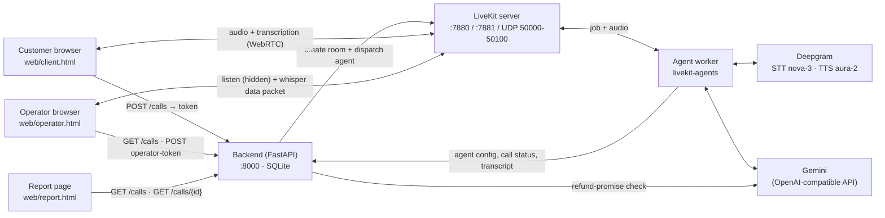

# Vexa Voice: Operator-Guided Voice AI Agent

A browser-based voice support line. A customer picks an AI agent and talks to it in real time over WebRTC.
A human operator can join any live call **invisibly**, listen in, read the live transcript and **whisper**
private instructions that the agent follows from its next reply on. When the call ends, the full transcript is saved
and two compliance checks are run on it automatically. A call report page shows the transcript and the
pass/fail result of each check.

Everything runs locally with Docker Compose, including the LiveKit media server (no LiveKit Cloud).

## Contents

- [Architecture](#architecture)
- [Tech stack](#tech-stack)
- [Project layout](#project-layout)
- [Prerequisites](#prerequisites)
- [Setup](#setup)
- [Using the app](#using-the-app)
- [Running without Docker (development)](#running-without-docker-development)
- [API reference](#api-reference)
- [Part A: Self-hosted LiveKit](#part-a-self-hosted-livekit)
- [How the agent works](#how-the-agent-works)
- [Operator whisper](#operator-whisper)
- [Compliance checks](#compliance-checks)
- [Latency](#latency)
- [Helper scripts](#helper-scripts)
- [Troubleshooting](#troubleshooting)
- [Production notes](#production-notes)

## Architecture



### Call flow

1. The customer page loads the agents (`GET /agents`) and the customer clicks **Call**.
2. The backend creates a `calls` row and a LiveKit room (`call-<random>`), and **explicitly dispatches** the
   `support-agent` worker into that room, passing `{call_id, agent_id}` as job metadata. It then returns a
   customer access token.
3. The browser joins the room and publishes its microphone.
4. The agent worker fetches the agent's config (prompt, voice, model, greeting) from the backend, waits for the
   customer, marks the call `active` and greets them. Speech flows as Deepgram STT → Gemini LLM → Deepgram TTS.
5. An operator sees the call under **Refresh active calls**, joins it as a hidden, listen-only participant and can send
   whispers.
6. When the call ends, the agent posts the transcript to the backend **first**, then marks the call `ended`. The backend
   runs the compliance checks in the background.

## Tech stack

| Part | Technology |
|------|------------|
| Media server | LiveKit server (`livekit/livekit-server`, Docker) |
| Agent | Python 3.12, `livekit-agents` 1.8.8, Silero VAD, LiveKit multilingual turn detector |
| Speech-to-text | Deepgram `nova-3` |
| Text-to-speech | Deepgram Aura 2 (default voice `aura-2-thalia-en`) |
| LLM | Google Gemini through its OpenAI-compatible endpoint (default `gemini-3.1-flash-lite`) |
| Backend | FastAPI, SQLModel, SQLite, `livekit-api` |
| Frontend | Plain HTML + `livekit-client` (CDN), served by nginx |

## Project layout

```text
voice-agent/
├── docker-compose.yml     # livekit, backend, agent, web
├── livekit.yaml           # LiveKit server config (ports, API key/secret)
├── backend/
│   ├── main.py            # REST API: agents, calls, tokens, transcripts
│   ├── compliance.py      # post-call compliance checks
│   ├── seed.py            # creates/updates the demo agents
│   ├── Dockerfile
│   └── requirements.txt
├── agent/
│   ├── agent.py           # the LiveKit voice-agent worker
│   ├── latency_report.py  # turns latency.jsonl into Markdown tables
│   ├── check_keys.py      # verifies the Gemini and Deepgram keys
│   ├── check_llm.py       # one test LLM request
│   ├── check_latency.py   # compares time-to-first-token across Gemini models
│   ├── make_token.py      # mints a LiveKit token for manual testing
│   ├── Dockerfile
│   └── requirements.txt
├── web/
│   ├── index.html         # start page: links to the three pages below
│   ├── client.html        # customer page
│   ├── operator.html      # operator console
│   └── report.html        # call report: compliance results + transcript
└── tokens.py              # early LiveKit smoke-test token generator
```

## Prerequisites

- **Docker Desktop** (or Docker Engine + Compose v2)
- **Python 3.10+** on the host, only to run `backend/seed.py` and the helper scripts. The seed script uses
  the standard library only.
- A **Deepgram** API key (STT + TTS): <https://console.deepgram.com>
- A **Google Gemini** API key: <https://aistudio.google.com/apikey>
- Chrome, Edge or Firefox, with microphone access

## Setup

### 1. Configure LiveKit

`livekit.yaml` holds the API key and secret that LiveKit uses to verify tokens. It is git-ignored, so create it
from the template first (`cp livekit.example.yaml livekit.yaml`):

```yaml
keys:
  devkey: "<your secret>"
```

To generate a new secret:

```bash
python -c "import secrets; print(secrets.token_hex(32))"
```

The **same key and secret** must go into `backend/.env` and `agent/.env` below.

### 2. Create the environment files

`backend/.env`

```env
LIVEKIT_URL=ws://localhost:7880
LIVEKIT_API_KEY=devkey
LIVEKIT_API_SECRET=<same secret as livekit.yaml>

GEMINI_API_KEY=<your Gemini key>
COMPLIANCE_MODEL=gemini-3.1-flash-lite
```

`agent/.env`

```env
LIVEKIT_URL=ws://localhost:7880
LIVEKIT_API_KEY=devkey
LIVEKIT_API_SECRET=<same secret as livekit.yaml>

DEEPGRAM_API_KEY=<your Deepgram key>
GEMINI_API_KEY=<your Gemini key>

# only used by check_llm.py
LLM_MODEL=gemini-3.1-flash-lite
```

Under Docker Compose, `LIVEKIT_URL`, `BACKEND_URL`, `DB_PATH` and `LATENCY_FILE` are overridden in
`docker-compose.yml` with the right in-network addresses, so the values above are only used when you run
the services directly on the host.

> **Never commit the `.env` files or the real secret in `livekit.yaml`.** Add them to `.gitignore`.

Optionally, check the keys before starting:

```bash
cd agent
pip install python-dotenv
python check_keys.py
```

### 3. Start everything

```bash
docker compose up --build
```

On the first build, the agent image downloads the Silero VAD and turn-detector model files
(`python agent.py download-files`), so this step takes a few minutes.

| Service | URL |
|---------|-----|
| Start page | <http://localhost:5500/> |
| Customer page | <http://localhost:5500/client.html> |
| Operator console | <http://localhost:5500/operator.html> |
| Call reports | <http://localhost:5500/report.html> |
| Backend API docs (Swagger) | <http://localhost:8000/docs> |
| LiveKit signalling | `ws://localhost:7880` |

Wait until the agent log shows that the worker registered with LiveKit (`registered worker`).

### 4. Seed the demo agents

With the stack running, from the project root:

```bash
python backend/seed.py
```

This creates (or updates, if they already exist) three agents:

| Agent | Purpose |
|-------|---------|
| **Maya** (Acme Telecom) | Compliant: discloses recording in the greeting and never promises refunds. |
| **Sam** (Zephyr Bank) | Compliant, with very short replies. |
| **Riley (non-compliant demo)** | Deliberately fails both compliance checks: no recording disclosure, and it promises refunds. |

You can also create your own agents with `POST /agents` (see the [API reference](#api-reference)).

## Using the app

### Customer

1. Open <http://localhost:5500/client.html>.
2. Choose an agent and click **Call**. Allow microphone access when asked.
3. The agent greets you. Speak normally; you can interrupt it mid-sentence.
4. The live transcript appears below the controls (interim text is faded).
5. Click **Hang up** to end the call.

### Operator

1. While a call is in progress, open <http://localhost:5500/operator.html> in another tab or browser.
2. Click **Refresh active calls**, then **Join silently** on a call.
   - The operator is a **hidden** participant: neither the customer nor the agent sees them join.
   - The operator is **listen-only** and cannot publish audio. Untick **Play audio** to read the transcript only.
     If you're on the same machine as the customer tab, use headphones or untick it to avoid echo.
3. Type an instruction, for example *"Offer the customer a free month of service"*, and click **Whisper**.
   The agent follows it from its next reply onwards, without mentioning that it was coached.
4. Click **Leave call** to disconnect. The call carries on without you.

### After the call

Open <http://localhost:5500/report.html> (or **View call reports** on the start page).

1. Pick a call from the dropdown. The newest call is selected by default. To open a specific call directly, use
   `report.html?call=<call_id>`.
2. The banner at the top shows the overall verdict: **ALL CHECKS PASSED**, **COMPLIANCE FAILED**, or
   *Running checks...* / *Waiting for the call to end* while the result isn't ready yet.
3. Under **Compliance checks**, each rule shows **PASS**, **FAIL** or **ERROR**, whether it was an LLM or a
   deterministic check, the reason, and the quoted line. A quote from the LLM is marked as verified when it was found
   in the transcript.
4. Under **Transcript**, every line is listed with its start and end time, speaker, and an *interrupted* tag where
   the customer cut the agent off.

The page polls the backend every 2 s while a call is still in progress or its checks are pending, and stops once the
result is final. Click **Refresh** to reload the list of calls.

You can also get the raw record, including the transcript and compliance result, from the API:

```bash
curl http://localhost:8000/calls/<call_id>
```

`compliance.status` is `pending` for a few seconds while the LLM check runs, then `done`.

## Running without Docker (development)

LiveKit still runs in Docker; the backend, agent and web pages run on the host.

```bash
# 1. LiveKit only
docker compose up livekit

# 2. Backend (terminal 2)
cd backend
python -m venv .venv
.venv\Scripts\activate          # macOS/Linux: source .venv/bin/activate
pip install -r requirements.txt
uvicorn main:app --reload --port 8000

# 3. Agent (terminal 3)
cd agent
python -m venv .venv
.venv\Scripts\activate
pip install -r requirements.txt
python agent.py download-files   # once
python agent.py dev              # hot-reloading worker

# 4. Web pages (terminal 4)
cd web
python -m http.server 5500

# 5. Seed agents
python backend/seed.py
```

The agent needs Python 3.12 or earlier, to match the Docker image. The backend's CORS allow-list accepts
`localhost:5500` and `localhost:5173`. If you serve the pages from another port, add it in `backend/main.py`.

## API reference

Interactive docs: <http://localhost:8000/docs>

| Method | Path | Description |
|--------|------|-------------|
| `GET` | `/agents` | List agents |
| `POST` | `/agents` | Create an agent: `name`, `system_prompt`, optional `voice`, `model`, `greeting` |
| `GET` | `/agents/{id}` | Get one agent |
| `PUT` | `/agents/{id}` | Replace an agent's config |
| `POST` | `/calls` | Start a call: `{"agent_id": 1}` → `call_id`, `room_name`, `livekit_url`, customer `token` |
| `GET` | `/calls?status=active` | List calls, without transcript/compliance (status filter is optional) |
| `GET` | `/calls/{id}` | Full call record, including `transcript` and `compliance` |
| `PATCH` | `/calls/{id}/status` | Agent → backend: `active`, `ended` or `missed` (`ended`/`missed` are final) |
| `POST` | `/calls/{id}/transcript` | Agent → backend: saves the transcript and starts the compliance checks |
| `POST` | `/calls/{id}/operator-token` | Hidden, listen-only token for an **active** call (409 otherwise) |

**Call lifecycle:** `created` → `active` (customer joined) → `ended`. A call becomes `missed` if no customer ever joins.
The room is deleted by LiveKit 120 s after it becomes empty.

Example: create an agent

```bash
curl -X POST http://localhost:8000/agents \
  -H "Content-Type: application/json" \
  -d '{"name":"Alex","system_prompt":"You are Alex, a concise support agent. Never use markdown.","greeting":"Hi, Alex here. This call is being recorded. How can I help?"}'
```

## Part A: Self-hosted LiveKit

LiveKit runs locally in Docker (`docker compose up`), not on LiveKit Cloud.
The API key and secret are my own, set in `livekit.yaml` (`devkey` / a random 64-character hex secret).

### Ports

| Port | Protocol | Purpose |
|------|----------|---------|
| 7880 | TCP | HTTP API and WebSocket **signalling**. Clients and agent workers connect here to join rooms, and SDP offers/answers and ICE candidates are exchanged over it. |
| 7881 | TCP | **ICE/TCP fallback.** Media is carried over TCP when UDP is blocked (for example by a corporate firewall). It has higher latency because of head-of-line blocking, but a call works instead of failing. |
| 50000-50100 | UDP | **Media (RTP/SRTP).** Audio and video travel over UDP because late packets are better dropped than waited for. Each connection uses one port from this range. The range is kept small because Docker creates one proxy per port. |

### Config notes
- `use_external_ip: false` because everything runs on localhost. On a public VM this would be `true`.
- **No TURN server is configured.** For local development, direct connections work. In production, TURN would be needed for users behind symmetric NAT or strict firewalls that block all UDP.
- Production would use a much wider UDP range, or a single muxed UDP port (`udp_port: 7882`), and TLS in front of 7880 (`wss://`).

### Two LiveKit URLs

The backend needs two addresses for the same server:

- `LIVEKIT_URL=ws://localhost:7880` is what the **browser** connects to, so it's returned inside each token response.
- `LIVEKIT_INTERNAL_URL=http://livekit:7880` is what the **backend container** uses for server API calls (create room,
  dispatch agent), via the Compose network name.

## How the agent works

`agent/agent.py` is a LiveKit Agents worker registered under the name `support-agent`. Because it has an
`agent_name`, it is **only** dispatched explicitly by the backend and never auto-joins rooms.

- **Per-call config:** the job metadata carries `agent_id`, so one worker serves every agent persona. Prompt, voice,
  model and greeting come from the backend.
- **Pipeline:** Silero VAD → Deepgram `nova-3` STT → Gemini (OpenAI-compatible) → Deepgram Aura TTS.
- **Turn-taking:** LiveKit's multilingual turn-detector model decides when the user has finished a thought, rather
  than relying on silence alone.
- **Interruptions:** the customer can barge in (VAD-based, minimum 0.3 s of speech). The greeting itself can't be
  interrupted, so the recording disclosure is always heard in full. Interrupted agent lines are flagged
  `interrupted: true` in the transcript.
- **Greeting only once someone is there:** the worker waits for the customer to join before greeting. If nobody
  joins, the call is marked `missed`.
- **Transcript:** each line stores `speaker`, `text`, `start_s` / `end_s` (seconds since the customer joined), an ISO
  `ts` and `interrupted`. Times come from when each side actually started and stopped speaking, not from when the
  line was committed.
- **Clean shutdown:** whether the session closes or the job shuts down, the transcript is posted exactly once, and
  before the `ended` status, so the call never shows as ended with no transcript.

## Operator whisper

- The operator token has `hidden: true`, `can_publish: false` and `can_publish_data: true`, so the operator is invisible,
  silent and can only send data.
- A whisper is a **reliable** LiveKit data packet on topic `operator-whisper`, addressed only to the agent's identity
  (`destinationIdentities`). The customer never receives it.
- The agent ignores whispers from any sender whose identity doesn't start with `operator-`, and truncates each
  whisper to 500 characters.
- Whispers are added to the agent's system instructions under a *private guidance* section (oldest first), with
  instructions to act on them naturally and never reveal them. They take effect from the agent's next reply.

## Compliance checks

These run in the background after `POST /calls/{id}/transcript`, and the result is stored in `calls.compliance`:

| Rule | Method | Passes when |
|------|--------|-------------|
| `recording_disclosure_within_30s` | **Deterministic** (regex, no LLM) | An **agent** line mentioning that the call/conversation is being recorded starts within 30 s of the customer joining. |
| `no_refund_promise` | **LLM** (Gemini, temperature 0, JSON-schema output) | The agent never commits to giving a refund. Explaining policy or offering to submit a request is allowed. |

The LLM's quoted offending line is **checked against the transcript** (`line_verified`) instead of being trusted as-is.
If the LLM call fails, that check's result is `passed: null`, with an `error` field.

Example result:

```json
{
  "status": "done",
  "all_passed": false,
  "checks": [
    { "rule": "recording_disclosure_within_30s", "passed": false,
      "reason": "The agent never said the call is being recorded." },
    { "rule": "no_refund_promise", "passed": false, "line_index": 3,
      "offending_line": "You will definitely get a full refund.", "line_verified": true }
  ]
}
```

Use **Riley (non-compliant demo)** to see both checks fail, and **Maya** to see both pass. The results are easiest to
read on the [call report page](#after-the-call).

## Latency

For every user turn, the agent records wall-clock timestamps for each pipeline stage and appends a row to
`latency.jsonl` (under Docker: `agent/data/latency.jsonl`):

```text
user stops speaking → STT final → turn committed → LLM first token → TTS first audio → audio published
```

Each row also includes LiveKit's own metrics (`fw_e2e_ms`, `fw_llm_ttft_ms`, `fw_tts_ttfb_ms`) for comparison.

To produce the report:

```bash
cd agent
python latency_report.py                  # reads agent/latency.jsonl
python latency_report.py data/latency.jsonl
```

On Windows, if the arrows in the table headers cause an encoding error, run `set PYTHONIOENCODING=utf-8` first
(PowerShell: `$env:PYTHONIOENCODING="utf-8"`).

**Measured results** (15 turns, local Docker, all values in ms):

| Stat | User stop → STT final | → Turn committed | → LLM first token | → TTS first audio | → Published | **Total** | Framework e2e |
|------|---:|---:|---:|---:|---:|---:|---:|
| median | 0 | 389 | 968 | 426 | 1 | **1802** | 2377 |
| p95 | 103 | 2423 | 1808 | 518 | 2 | **4231** | 4806 |
| max | 107 | 2428 | 3313 | 1387 | 3 | **5147** | 5722 |

The largest costs are the LLM's time to first token and the turn detector waiting to be sure the user has finished.
`check_latency.py` compares time to first token across Gemini models, to help choose the fastest one.

## Helper scripts

Run these from `agent/` (they read `agent/.env`):

| Script | What it does |
|--------|--------------|
| `python check_keys.py` | Confirms the Gemini and Deepgram keys work, and lists the available Gemini Flash-Lite models |
| `python check_llm.py` | Sends one chat request to `LLM_MODEL` and prints the reply and duration |
| `python check_latency.py` | Measures network baseline and time-to-first-token for several Gemini models |
| `python make_token.py <room> <identity>` | Prints a LiveKit join token, e.g. for <https://meet.livekit.io> custom server testing |
| `python latency_report.py [file]` | Markdown latency tables (see [Latency](#latency)) |

## Troubleshooting

| Symptom | Fix |
|---------|-----|
| Agent dropdown is empty / "Could not load agents" | Backend not running, or the agents weren't seeded. Check <http://localhost:8000/agents> and run `python backend/seed.py`. |
| Call connects but the agent never speaks | Check `docker compose logs agent`. Usually a bad Deepgram/Gemini key (run `check_keys.py`), or the worker isn't registered yet. |
| `LiveKit error` (502) from `POST /calls` | The backend can't reach LiveKit, or the API key/secret in `backend/.env` doesn't match `livekit.yaml`. |
| Connected but no audio either way | UDP 50000-50100 is blocked or already in use. Check the firewall; media falls back to TCP 7881. |
| Browser connects only after granting the mic | Intended: both pages request mic permission **before** connecting, so the browser exposes usable ICE candidates instead of mDNS-only ones for Docker. |
| Call report says "Could not reach the backend" | The backend isn't running on `localhost:8000`. `report.html` calls that address directly. |
| CORS error in the browser console | Serve the pages from port 5500 (or 5173), or add your origin to `allow_origins` in `backend/main.py`. |
| Operator sees "call is not active" (409) | The customer hasn't joined yet, or the call has already ended. Refresh the list. |
| `compliance.status` stays `pending` | The refund check is still running, or failed. Check `docker compose logs backend`. |
| No sound after joining | The browser blocked autoplay. Click anywhere on the page. |

Reset all call and agent data (removes the SQLite volume):

```bash
docker compose down -v
```

## Production notes

This is a local, single-machine setup. Before exposing it:

- Put TLS in front of LiveKit (`wss://`) and the backend, and set `use_external_ip: true` on a public host.
- Add a TURN server for users behind restrictive NATs or firewalls.
- Add authentication: currently anyone who can reach the backend can start calls or mint operator tokens.
- Move secrets out of `livekit.yaml` and `.env` files into a secret manager, and use a stronger database than SQLite.
- Pin the `livekit/livekit-server` image to a specific version instead of `latest`.
